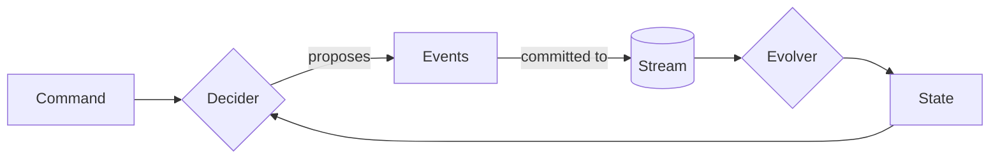

# Key concepts

Event sourcing stores what happened, not what things currently look like. Current state is worked out from the
history whenever it is needed.

Akashic's aim is to let you spend your time on the part that is yours: the commands your domain accepts, the events
that can happen in it, and the state those events add up to. Loading, storing, concurrency, retries and delivery are
the framework's job. If you can describe your domain as commands, events and state, you have written most of the
code.

## The pieces you write

| Concept | What it is | In the sample |
|---------|------------|---------------|
| Command | A request to do something. It can be refused. | `Withdraw(30)` |
| Event | A fact that has happened. It is never refused and never changed. | `Withdrawn(30)` |
| State | What a decision needs to know, worked out from the events so far. | `AccountState(balance = 70)` |
| Decider | The rules: given state and a command, which events happen, if any. | `AccountDecider` |
| Evolver | The meaning of each event: given state and an event, the next state. | `AccountEvolver` |

These five are plain Kotlin with no framework calls inside them. They are grouped per **aggregate**: one
consistency boundary with its own ordered stream of events, such as a single bank account.



### Commands and events

Name commands in the imperative and events in the past tense. A command expresses intent and carries the inputs a
decision needs. An event records the outcome and carries what later readers need in order to understand it without
the command.

One command may produce several events, exactly one, or none. Events are the only thing stored, so anything not in an
event is forgotten.

### State

State exists to make decisions. It holds what the decider must check, such as a balance, and nothing more. It is
never stored as the source of truth. It can always be thrown away and rebuilt from the events, which is what makes
changing its shape cheap.

What users see on screen is usually a different shape again, and belongs in a read model.

### The decider

A decider answers one question: given this state and this command, what happens? It returns events, a rejection with
a reason, or "nothing to change". It does not change state, write anything, or call other systems. That keeps every
business rule in one place, testable with ordinary function calls.

### The evolver

An evolver answers the other question: given this state and this event, what is the state now? It never refuses an
event, because the event has already happened. It must be deterministic, because it runs again every time history is
replayed.

Keeping the decider and evolver apart is deliberate. Deciding needs the command side: current state, a writer, and
concurrency control. Evolving needs only events. An evolver therefore works anywhere events are available, with
nothing else from the command side present.

## Evolvers in read-only contexts

Because an evolver is a pure fold over events, you can use it wherever you want to know what the events mean,
without being able to change anything.

**State at a point in history.** Read a stream up to a version and fold it:

```kotlin
```
{src="src/main/kotlin/AccountReadOnly.kt" include-symbol="accountAsOf"}

**Read models.** A subscriber can fold delivered events with the aggregate's own evolver, so a read model never
restates the domain's arithmetic:

```kotlin
```
{src="src/main/kotlin/AccountReadOnly.kt" include-symbol="AccountDirectory"}

**Snapshots.** The snapshot maintainer is exactly this: a subscriber that folds events with the evolver and stores
the result. It is built from the evolver alone and has no access to the decider.

**Query views.** An `AggregateViewMapper` turns committed state into a presentation view, so queries can reuse state
the evolver already produces.

The framework's own types mark the split. An `AggregateDefinition` carries everything, and it is also an
`AggregateStateDefinition`: the aggregate type and evolver only. Read-only tooling asks for that narrower type, so it
cannot reach the decider. Stores are split the same way, into `AggregateEventStoreRead` and
`AggregateEventStoreWrite`.

## The pieces the framework provides

### Definition

An `AggregateDefinition` gathers the decider, the evolver, the stored names of the events, and the codec that turns
events into bytes. It is declared once and everything else is built from it.

### Event store

An event store keeps one ordered stream per aggregate and accepts appends only at the version the writer expected.
That check is what makes concurrent commands safe: two writers who decided on the same state cannot both commit.
Stores expose reading and appending and nothing else. The in-memory, PostgreSQL and KurrentDB stores are
interchangeable.

### Aggregate service

The service is what your application calls. `handle(command)` does the plumbing for one command:

1. Load the aggregate's state, from a snapshot and the events after it, or from the full stream.
2. Ask the decider.
3. Prepare the proposed events and append them at the expected version.
4. Fold the committed events into state with the evolver and return the result.

`getById` returns current state without a command. Services come in a reloading form, which loads on every call, and
a caching form; see [](command-results.md).

### Subscriptions

A subscription source delivers committed events, in order, to subscribers that build read models or trigger further
work. See [](subscriptions.md).

### Backend provider

A provider builds stores, services, subscription sources and runners for one storage technology. Application code is
written against the provider interface, so the same code runs in memory in tests and on a database in production.

## Where to go next

[](getting-started.md) writes each of these pieces for the bank account.
