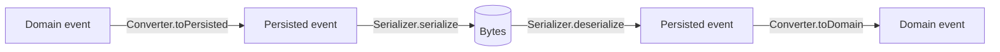

# Events and codecs

Events are stored forever, and your domain model will keep changing. Akashic keeps the two apart with two models for
every event:

- The **domain event** is what deciders produce and evolvers consume. It is free to change with the code.
- The **persisted event** is the shape on disk. It only ever changes in backward-compatible ways.

A `Codec` joins them. It has a `Serializer`, which turns the persisted model into bytes, and a `Converter`, which maps
between the persisted and domain models. The converter is the single place where old data meets current code, so the
rest of the domain never deals with history.



## Use Protobuf for the persisted model

Protobuf suits stored events well. Fields are identified by number, so renaming a property changes nothing on disk.
Unknown fields are skipped and missing fields take defaults, so old and new code can read each other's events. The
encoding is compact. With `kotlinx.serialization` the schema is plain Kotlin:

```kotlin
plugins {
    kotlin("plugin.serialization")
}

dependencies {
    implementation("org.jetbrains.kotlinx:kotlinx-serialization-protobuf:1.10.0")
}
```

Write the persisted model as mirror classes, named here with a `P` suffix. Give every field an explicit
`@ProtoNumber`. Model the sealed hierarchy as a oneof: a wrapper holding one `@ProtoOneOf` property whose type is a
sealed interface with one subclass per event.

```kotlin
```
{src="src/main/kotlin/AccountCodec.kt" include-symbol="AccountEventP,AccountEventOneOfP,AccountOpenedP,AccountDepositedP,AccountWithdrawnP,AccountFlaggedP,AccountTransferSentP"}

One serializer covers every persisted model:

```kotlin
```
{src="src/main/kotlin/AccountCodec.kt" include-symbol="ProtoSerializer"}

## Convert between the two models

```kotlin
```
{src="src/main/kotlin/AccountCodec.kt" include-symbol="AccountEventConverter,AccountEventCodec"}

Both `when` expressions are exhaustive over a sealed type. Adding an event to either model fails compilation until
the converter handles it.

## Evolving events

Every stored event must always convert to exactly one domain event. Stream versions and subscription checkpoints
advance once per stored record, so a converter never drops an event or splits one in two.

### Rename something in the domain

Change the domain class and the converter. The persisted model stays as it is. In the sample, the domain calls the
field `owner` while storage still calls it `ownerName`.

### Add a field

Add it to the persisted class with a new field number and a default. Events stored earlier decode with the default,
and the converter decides what that means for the domain. `AccountDepositedP.reference` was added this way.

### Retire an event

An event the domain no longer cares about still sits in its streams and still holds a version. Keep its persisted
class and field number, and convert it to a single no-op domain event that the evolver ignores explicitly.
`AccountFlaggedP` converts to `AccountEvent.Retired`.

Keep the retired event's stored name in the type registry too. Subscriptions skip records whose name is not
registered, which would hide the event from snapshot maintenance:

```kotlin
```
{src="src/main/kotlin/Account.kt" include-symbol="AccountEventTypes"}

### Change an event's meaning

Add a new persisted variant with a new field number and a new event name, and start writing that. Keep reading the
old variant, converting it to whatever the current domain model needs.

### Rules that keep stored data readable

- Never reuse or renumber a `@ProtoNumber`.
- Never change a field's type.
- Never rename a stored event name in `EventTypeNames`.
- Give every added field a default.
- Bytes that cannot be decoded are an error. Replay and subscriptions stop on them; they are never skipped.

> `DirectCodec` uses one class as both models. It is convenient in tests, but any domain change then alters stored
> data, so do not use it for events you intend to keep.
>
{style="warning"}

## Test the codec

Converters are plain functions, so they are cheap to test. Keep a test for every evolution you make. The old shape of
a class can live in the test:

```kotlin
```
{src="src/test/kotlin/AccountCodecTest.kt" include-symbol="AccountCodecTest"}
