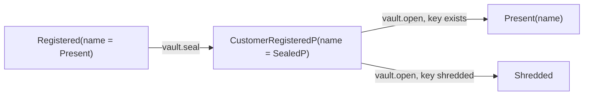

# Personal data and erasure

Events are kept forever, and a person has the right to be forgotten. Akashic reconciles the two with cryptographic
shredding: personal data is stored encrypted under a key that belongs to the data subject, and erasing the subject
means destroying that key. The events stay where they are, their versions and checkpoints intact, but the personal
fields in them can never be read again.

```kotlin
dependencies {
    implementation("codes.laurence.akashic:akashic-crypto:%akashic_version%")
}
```

`akashic-crypto` depends on `akashic-core` and `kotlinx-serialization-protobuf`, and encrypts with the JDK's AES-GCM.
The PostgreSQL key store ships in `akashic-backend-exposed`.

## The three parts

- **`Shredable<T>`** is how the domain holds personal data: `Present(value)` while the subject's key exists, `Shredded`
  afterwards. There is no fake value; code that needs one chooses it with `valueOr { "Former customer" }`.
- **`SealedP`** is how it is stored: AES-256-GCM ciphertext, the nonce, and the ID of the key it was sealed under. It is
  a `@Serializable` Protobuf message you embed in your persisted models.
- **`SubjectVault`** joins them. The converter calls `seal` on the way to storage and `open` on the way back, for
  events and snapshot state alike, so one `shred` covers every stored copy.



Behind the vault sit two SPIs. A `SubjectKeyStore` holds one data key per subject, wrapped, and keeps a tombstone when
the key is shredded. A `KeyWrapper` encrypts those keys with a wrapping key that lives somewhere else, such as a secret
store or a cloud key-management service, so the key store alone reveals nothing. `AesGcmKeyWrapper` wraps with a
local key; a KMS adapter implements the same two functions.

## Model the subject in the domain

Personal fields are `Shredable`, and the event names the subject whose key seals them. Here the customer is the subject,
so the registration command carries the customer ID for the event to keep:

```kotlin
```
{src="src/main/kotlin/codes/laurence/akashic/examples/bank/Customer.kt" include-symbol="CustomerCommand,CustomerEvent,CustomerState"}

The subject need not be the aggregate. An account event that carried its holder's name would seal it under the
customer's key, and erasing the customer would blank it in every account.

The evolver forgets as soon as the erasure event is applied. That keeps the domain deterministic whether or not the
shred has happened yet, and keeps plaintext out of in-memory state from then on:

```kotlin
```
{src="src/main/kotlin/codes/laurence/akashic/examples/bank/Customer.kt" include-symbol="CustomerEvolver"}

## Seal in the converter

The persisted model holds `SealedP` where the domain holds `Shredable`:

```kotlin
```
{src="src/main/kotlin/codes/laurence/akashic/examples/bank/CustomerCodec.kt" include-symbol="CustomerRegisteredP,CustomerEmailChangedP"}

The converter takes the vault and seals under the subject named in the event. Both directions are `suspend`, so a key
lookup fits naturally; the stores call the codec outside their transactions:

```kotlin
```
{src="src/main/kotlin/codes/laurence/akashic/examples/bank/CustomerCodec.kt" include-symbol="CustomerEventConverter,customerEventCodec"}

Because the codec needs the vault, the aggregate definition is built once with it rather than declared as a constant:

```kotlin
```
{src="src/main/kotlin/codes/laurence/akashic/examples/bank/Customer.kt" include-symbol="customerDefinition"}

Snapshot state seals the same way, under the same subject, so a shred covers snapshots too. A snapshot written after
the erasure holds the `SealedP.SHREDDED` marker instead of ciphertext:

```kotlin
```
{src="src/main/kotlin/codes/laurence/akashic/examples/bank/CustomerCodec.kt" include-symbol="CustomerStateP,CustomerStateConverter"}

## Erase a subject

Erasure is a command plus a shred. Commit the event first, so the history always shows that the request was honoured,
then destroy the keys. Shredding is idempotent, so if it fails after the event committed, erasing again finishes the
job:

```kotlin
```
{src="src/main/kotlin/codes/laurence/akashic/examples/bank/Customer.kt" include-symbol="CustomerErasure"}

After the shred, every value sealed under the subject's keys opens as `Shredded`. Replay, subscriptions and snapshot
loads keep working; stream versions and checkpoints do not move. If the same subject comes back later, new data is
sealed under a fresh key and is shreddable again, while the old data stays unreadable.

A value whose key the store has never issued is different: that data was not erased on purpose, so `open` throws
`UnknownSubjectKeyException` and replay stops, the same as any other undecodable event.

## Wire the vault

One vault per deployment. The key store is shared by every instance, and the wrapping key comes from configuration:

```kotlin
```
{src="src/main/kotlin/codes/laurence/akashic/examples/bank/Wiring.kt" include-symbol="subjectVault,postgresVault,memoryVault"}

`SubjectKeyStoreExposed` keeps keys in the `subject_keys` table that the backend's migrations create. Two instances
sealing a new subject's first value at the same time resolve to one key. `SubjectKeyStoreInMemory` serves tests and
single-process applications.

The vault caches unwrapped keys for a minute by default (`KeyCachePolicy`). Sealing or opening a thousand fields of one
subject costs one key store round trip, and a shred performed on another instance takes effect here within the cache's
time to live. Shred on the instance that handles the erasure and that instance forgets at once.

## What shredding does not cover

- Values an application has already decoded and holds in memory, including cached aggregates and read models. They
  age out or are rebuilt from the history, which now opens as shredded.
- Fields outside `Shredable`. Only what you seal is protected; the aggregate ID and event names stay readable.
- Backups of the key store taken before the shred. Treat the key store like the secret it is.

## Test it

The in-memory key store makes erasure testable without a database. Read the history back after the shred and assert
that the personal fields are `Shredded` while the events and versions remain:

```kotlin
```
{src="src/test/kotlin/codes/laurence/akashic/examples/bank/CustomerErasureTest.kt" include-symbol="CustomerErasureTest"}
